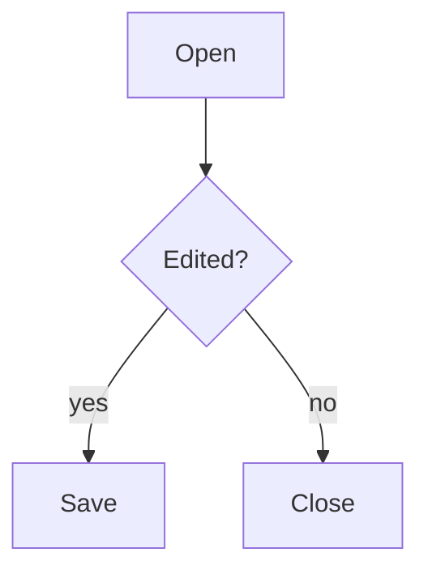

# Slice 7 under the model core — hand check

This file is the protocol and the document it runs on, in one. Open it in the
app, follow the steps, and edit the paragraphs written for each one. **Bold** is
what you do; *italics* is what should (or should not) happen.

It grows with TODO 3.1's slice 7: each step that needs a person adds its
section here. Today it holds step 2's, the diagrams and the maths.

## Before you start

1. **Run the server** (`npm run serve`) and **open
   `http://localhost:9130/?core=model`**. *The toolbar shows a `model core`
   marker.* If it does not, you are testing the old core and none of this
   means anything.
2. **Open the browser console and run `modelVerifySetEnabled(true)`.**
   Throughout, *the console stays free of `[model] render diverged` warnings*.
   One appearing is a failure, whichever step it came in.
3. **File → Open this file** (`tests/fixtures/format-check.md`).

**Never save over this file.** It is the pristine copy every run starts from.
To start again, use **File → Reload** and choose to discard.

"Ctrl/Cmd" means Cmd on a Mac and Ctrl elsewhere. Redo is Ctrl/Cmd+Shift+Z, or
Ctrl+Y.

## Diagrams and maths survive a render (step 2)

The model core draws the document again after every edit — all of it on Enter,
undo and paste, one block on an ordinary keystroke. Until step 2 that took
every diagram back to its code and every equation back to its TeX. What is
checked here is that they stay drawn, and never show their source even for an
instant.

The diagram and the display equation this section runs on:



$$\int_0^1 x^2 \, dx = \frac{1}{3}$$

1. **Wait until the diagram and both equations on this page have been drawn,
   then click at the end of this sentence and press Enter three times.** *The
   diagram and the equations stay drawn throughout, and you never see the
   diagram's code or a `$` sign, not even as a flicker.*

2. **Press Ctrl/Cmd+Z three times, then Ctrl/Cmd+Shift+Z three times.**
   *Same: everything stays drawn, and the empty paragraphs come and go.*

3. This paragraph holds an inline equation, $e^{i\pi} + 1 = 0$, in the middle
   of a sentence. **Click just after the equation and type a few letters, then
   press Backspace once.** *The equation stays drawn with every keystroke, and
   the letters appear right after it.*

4. **In the same paragraph, press the Left arrow until the caret has crossed
   the equation, then type a letter.** *One press of Left crosses the whole
   equation, as if it were a single character, and the letter lands just
   before it.*

5. **Switch the theme with the sun/moon toggle, then press Enter somewhere
   in this sentence and Ctrl/Cmd+Z it away.** *The diagram redraws in the new
   theme's colours when you toggle, and keeps them through the Enter and the
   undo — it does not flash back to the old theme.*

6. **Reload the page (not File → Reload — the browser's own), let it finish,
   and run this in the console:**
   `document.querySelectorAll('#editor mjx-container mjx-container').length`
   *It prints `0`.* Anything else means a reload has nested a copy of an
   equation inside itself — the bug fixed on `main` on 2026-09-29. **Reload
   and run it twice more.** *Still `0`.*

7. **Open this file in a second, fresh browser window** (so MathJax has not
   been loaded in it yet), **and press Enter in this sentence as soon as the
   page appears.** *The equations may appear a moment after the rest of the
   page — that is MathJax loading — but they do appear, and stay drawn after
   the Enter.*

A broken diagram, for the last step:

```mermaid
graph TD
    A --> -->
```

8. **Press Enter at the end of this sentence.** *The broken diagram above
   shows `Mermaid Error:` followed by Mermaid's own message, and its source
   below it — both before and after the Enter.*
